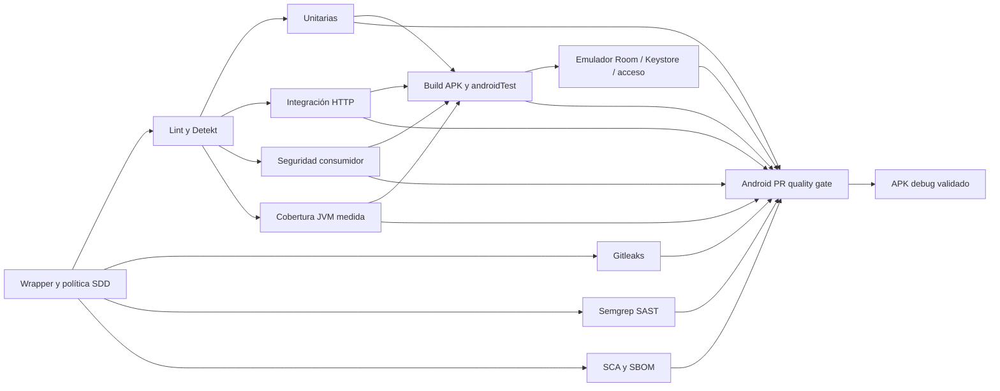

# Pipeline Android — preparación local y evidencia

Un solo disparador en [android-ci.yml](../../.github/workflows/android-ci.yml), con escáneres reutilizados en [android-security.yml](../../.github/workflows/android-security.yml). Segundo archivo es workflow_call, sin push/PR propios: no dispara duplicados. Preparado para PR, push y ejecución manual. Sin CD, Docker de aplicación, despliegue backend ni Play.

## Comprobaciones obligatorias

- Wrapper integrado en setup-gradle antes de cualquier Gradle. Acciones fijadas a SHA y permisos contents:read. No hay secretos para pruebas consumidor.
- Tres categorías con resultados JUnit, IDs por operación y fallo ante pruebas ausentes/duplicadas/omitidas. Se conservan pruebas anteriores y casos compartidos.
- Cobertura JaCoCo 0.8.14 integrada en AGP, sobre suite completa y alcance predeterminado del plugin, incluyendo UI/código generado. Gate exige medición/inventario no vacíos e informes íntegros; **no certifica un mínimo porcentual**. No se copia el 45 % de la referencia ni se excluye código para elevar el número.
- Gitleaks, Semgrep y Trivy/SBOM reutilizan motores fijados, sanitización y manifestación de estado. Hallazgo, error de herramienta o informe ausente fallan; subir artefacto no convierte fallo en éxito.
- Build genera APK debug y APK de pruebas. Emulador CI API 35/google_atd/x86_64 con acción oficial fijada; ejecuta cinco métodos offline por selector explícito y compara APK instalado con candidato. Arranque/instalación/runner fallidos no se aceptan por exit code 0 de adb.
- Gate valida resultados de todos los trabajos, run/attempt/source, helper/matriz, huellas de informes/APKs, inventario SBOM y casos exactos. Estados skipped/cancelled/missing no equivalen a PASS. Artefactos se conservan siete días aun cuando un trabajo falla.
- Solo después del gate se reexpone el mismo APK como pactogg-debug-validated, sin recompilar otro candidato. Antes existe android-build, explícitamente candidato sin aprobación de calidad.

## Entrega pendiente

El grafo verde real aparecerá en GitHub cuando se autoricen los commits/ramas/PR y se ejecute el workflow. Hasta entonces solo se acredita configuración y verificación local. Recomendar el check estable **Android PR quality gate** y revisión humana en reglas de main; no afirmar protección efectiva sin inspección/configuración autorizadas. Ningún job local sustituye aceptación del profesor.

No se agregan Pact-real, mutación, carga/chaos, ZAP, SQL Server, Terraform o publicación automática: no son controles móviles obligatorios corroborados para este corte. No se migran Hilt/JUnit4/stack por copiar el ejemplo.

[Comparación de fuente](../preparacion/comparacion-profesor-calidad-2026-11-04.md) · [Matriz de operaciones](matriz-operaciones.md).
